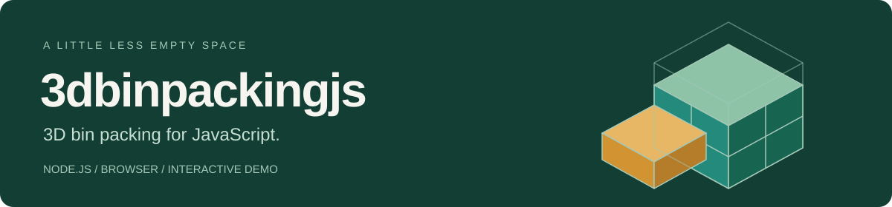

<p align="center">
  
</p>

<p align="center">
  <a href="https://github.com/keremdemirer/3dbinpackingjs/actions/workflows/test.yml"></a>
  
  
</p>

# 3dbinpackingjs

Arrange rectangular boxes inside a single container with a JavaScript packing
heuristic, a standalone API, and an interactive 3D demo.

**[Try the demo](https://keremdemirer.github.io/3dbinpackingjs/)** ·
[API reference](docs/API.md) · [Demo guide](docs/DEMO.md) ·
[Benchmarks](https://github.com/keremdemirer/3dbinpackingjs/blob/master/bench/README.md) · [Contributing](https://github.com/keremdemirer/3dbinpackingjs/blob/master/CONTRIBUTING.md)

> **Project status:** Available from a repository checkout. Not published to npm;
> upstream licensing is unresolved. Read the [license status](LICENSE-STATUS.md)
> before adopting or redistributing the code.

## What it does

| Capability | Details |
| --- | --- |
| Packing | Single-container EB-AFIT heuristic for rectangular boxes. |
| Search effort | Standard by default; optional extended search tries a second policy. |
| Rotation rules | Free, upright, or fixed per box type. |
| Downward settling | Optional post-pass closes vertical gaps while preserving packed volume. |
| JavaScript API | CommonJS, ES modules, and plain browser scripts; no runtime dependencies. |
| TypeScript | Included declarations for Node.js and the browser namespace. |
| Interactive demo | Inspect placements, rotate the view, and export JSON or PNG. |
| Validation | Independent geometry checks, seeded regressions, and reproducible benchmarks. |

## JavaScript API

Requires Node.js 22 or later. From the repository root:

```js
const { pack } = require('./pack.js');

const result = pack({
  container: { width: 4, height: 3, depth: 2 },
  items: [{
    id: 'carton', width: 2, height: 3, depth: 4,
    quantity: 1, rotation: 'upright'
  }],
  settle: true
});

console.log(result.packedCount); // 1
console.log(result.utilization); // 1 (100%)
console.log(result.placements);  // Positions and rotated dimensions
```

For ES modules, import from `./pack.mjs`. In a browser, load `pack.js` and call
`BinPacking.pack(...)`. The solver is synchronous, does not modify input objects,
and returns independent results. Use one consistent measurement unit.

For an optional second search pass, set `search: 'extended'`; see the
[quality/runtime tradeoff](docs/API.md#search-effort).

See the [complete input/output reference](docs/API.md),
[TypeScript usage](docs/API.md#typescript), and
[local package archive instructions](docs/API.md#package-archive).

## Rotation rules

| Rule | Behavior |
| --- | --- |
| `free` (default) | Permute width, height, and depth. |
| `upright` | Keep original height on Y; width/depth may swap. |
| `fixed` | Preserve all three original axes. |

Rules always refer to the original container axes.
[Settling is optional](docs/API.md#optional-downward-settling) and defaults to
`false` in the API; the demo enables it through a checkbox.

## Explore the demo

[Open the online workbench](https://keremdemirer.github.io/3dbinpackingjs/) or open
`index.html` locally. Choose an example, edit box quantities and rotation rules,
and calculate the arrangement. Select a box to inspect its coordinates and base
contact. See the [demo guide](docs/DEMO.md) for controls and exports.

## Limits to keep in mind

- This heuristic does not guarantee optimal packing.
- Geometric fit and downward settling do not guarantee physical stability.
  Weight, balance, and load-bearing strength are not modeled; overhangs may remain.
- Prefer integer dimensions in consistent units. A general decimal precision
  policy is not provided.
- The online demo calculates in a cancellable background worker. The synchronous
  library API and direct-file demo fallback can block the calling thread; displaying
  very large results can still pause the demo.

## Development

```sh
npm ci
npm run check        # Runtime/package tests and TypeScript checks
npm run bench:check  # Recorded packing-quality baseline
npm run bench:quick  # Short timing and quality run
```

Read the [contribution guide](https://github.com/keremdemirer/3dbinpackingjs/blob/master/CONTRIBUTING.md),
[testing guide](docs/TESTING.md), and [benchmark methodology](https://github.com/keremdemirer/3dbinpackingjs/blob/master/bench/README.md).
Timing comparisons are observational; CI checks correctness and packed volume.

## Documentation

| Guide | Contents |
| --- | --- |
| [API reference](docs/API.md) | Inputs, results, rotations, settling, TypeScript, and package archives. |
| [Demo guide](docs/DEMO.md) | Camera controls, box inspection, exports, and limitations. |
| [Benchmarks](https://github.com/keremdemirer/3dbinpackingjs/blob/master/bench/README.md) | Reproducible measurements, quality references, and optimization reports. |
| [Testing](docs/TESTING.md) | Geometry, regressions, package checks, and validation scope. |
| [Changelog](CHANGELOG.md) | Unreleased changes and integration notes. |
| [Documentation index](docs/README.md) | Repository layout and site maintenance. |

## Provenance and license

The solver is a JavaScript conversion of
[wknechtel/3d-bin-pack](https://github.com/wknechtel/3d-bin-pack/), derived from
Erhan Baltacıoğlu’s EB-AFIT work. Keep the upstream attribution intact.

The package remains private and `UNLICENSED` pending verified upstream
permissions. MIT is the preferred future license, but no project-wide license
grant is currently asserted. See [license status and provenance](LICENSE-STATUS.md).
